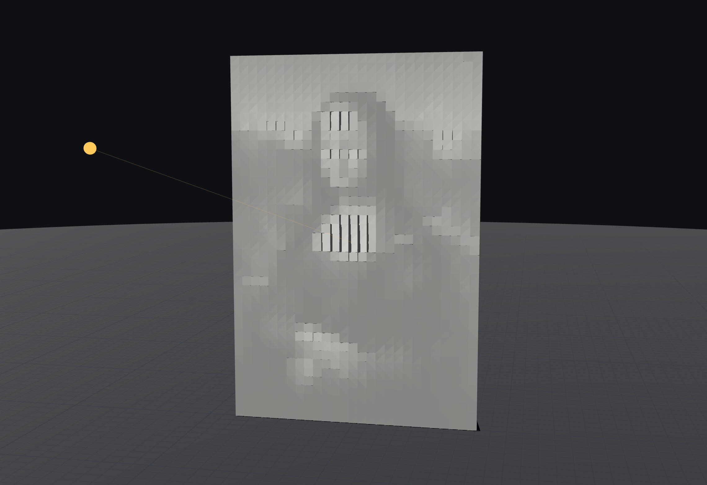

# M1 end-to-end proof (verify round 1)

2026-10-20, first run on `main` at `a1a9cbe`. **Re-run after the round 1 fixes** (same day, commit "M1: fix verification findings (round 1)"): the outputs, logs and validation numbers below are from the re-run; the screenshots, `bench.log`, `check_3mf_trimesh.log` and `tauri-dev*.log` are from the first run. The machine was shared with other agents (load 4–7), so the timings are indicative.

## What was tested

- **Input:** `tests/fixtures/mona-lisa.jpg`. The Mona Lisa (C2RMF retouched, public domain) from Wikimedia Commons, re-encoded by `sips` to 1006 × 1500 px (770 KB).
- **Printer:** the default profile, Creality CR-6 SE (235 × 235 × 250 mm, bed moves in Y). The margin is now 8 mm (room for a brim; it was 5 mm in the first run).
- **Two code paths:**
  - **CLI:** release `target/release/ad3d`, every run with `--strict` (self-intersection stage on).
  - **App:** the `SquamaState` methods behind the Tauri commands (`squama_image_open`, `generate_squama` at preview then final quality, `squama_target`, `squama_tile_plan`, `export_squama`). The harness is `src-tauri/src/e2e_m1.rs`; run it with `cargo test -p ad3d-app e2e_m1 -- --ignored --nocapture`. The commands only wrap these methods in `spawn_blocking`; the IPC layer itself was exercised by the live app run in the Screenshot section.
- **Logs:** `docs/m1/logs/` (`cli-*.log`, `app-e2e.log`, `validate-ad3d.log`, `validate-summary.tsv`, `check_mesh.log`, `check_3mf_trimesh.log`, `bench.log`, `tauri-dev*.log`).

## Results

Generation and export work end to end on both paths. Every part of every output is a closed, consistently wound, positive-volume mesh with 0 self-intersecting triangle pairs. Three independent checks agree on this: `ad3d validate --strict`, `tools/check_mesh.py` (trimesh), and trimesh on each 3MF object.

Five findings follow below, ranked. None of them breaks the exported geometry.

## Outputs

All paths are relative to the repo. Each STL has a matching 3MF in the same folder with every part laid out on the bed.

| Case | CLI flags (beyond `--image … --format stl,3mf --strict`) | CLI output | App output | Plate / parts |
|---|---|---|---|---|
| LuBan default (300 / 6 / 5° / 10° / 3) | `--tiles none --orientation flat` | `out/cli/default/squama.{stl,3mf}` | `out/app/luban-default/` | 50 × 75 cells, 300 × 450 mm, 25 154 tris. Warns `part_exceeds_bed` (expected; the part report now says `fitsBed: false`) |
| CR-6 SE, one piece, standing | `--width 160 --tiles none --orientation standing` | `out/cli/cr6-onepiece/` | `out/app/cr6-onepiece/` | 27 × 40 cells, 162 × 240 mm. Prints 3.8 × 162 × 240 (face along Y). Height/footprint 63: warns `tall_standing_tile` and `brim_recommended` |
| 300 × 378, tiled, keys, stand | `--width 300 --height 378 --tiles auto --keys pegs --stand --orientation standing` | `out/cli/tiled-300x378/` | `out/app/tiled-300x378/` | 2 × 2 tiles, cols 25/25 × rows 27/36 (Y 162/216 × Z 150 mm, ≤ 40 × thickness), `key_splints` (21 shells), 2 stands. **Two beds, two 3MFs:** `squama.3mf` (4 tiles + splints), `squama_bed2.3mf` (stands) |
| Hex cells | `--width 160 --layout hex --tiles none --orientation standing` | `out/cli/hex/` | `out/app/hex/` | 53 × 46 pointy hex, 159.0 × 239.0 mm, 17 116 tris |
| Point light (−400, 120, 80) mm | `--width 160 --light-point=-400,120,80 …` | `out/cli/point/` | `out/app/point/` | 162 × 240 mm, depth 4.3 mm |
| Optimised | `--width 160 --optimise shadow …` | `out/cli/optimised/` | `out/app/optimised/` | 8 sweeps, match r 0.974 → 0.992, rel. RMSE 0.030 → 0.017. Still warns `downward_ledge` 0.70 mm (see the checklist) |
| Calibration tile | `ad3d calibration --out … --strict` | `out/cli/calibration/calibration.{stl,3mf,key.json}` | `out/app/calibration/` (with the plate) | 120 × 84 mm, 12 steps **−5.7°…10°** (one black step, ledges ≤ 0.60 mm), light side Left |
| Extra: hex + tiled + optimised + calibration tile + project | `--width 300 --height 378 --layout hex --optimise shadow --tiles auto --keys pegs --stand --calibration-tile --save-project …/job.ad3d` | `out/cli/hex-tiled-opt-cal/` | — | Plate 300 × **374.1** mm (an explicit hex height now snaps down). 2 × 2 tiles (Y 187.1 × Z 150), splints (22 shells), 2 stands, calibration tile (ledge 0.60 mm), two beds / two 3MFs, `job.ad3d` |

The CLI and the app produce identical meshes for the same settings (same triangle counts and volumes).

The app run's timings: the photo opens in 57 ms on the first call. Preview generates in 1.2–3.4 ms with the photo cached. Final quality takes 19–87 ms (test profile, `validate()` on, `validated: true` every time). Exports take 123–540 ms.

## Validation

Re-run on 53 files (37 STLs, 16 3MFs: one 3MF per bed now). Script: every file through `ad3d validate --strict`, every STL through `tools/check_mesh.py`.

| Check | Result |
|---|---|
| `ad3d validate --strict` (STL and 3MF) | **53/53 OK**, self-intersecting pairs 0 everywhere. Multi-shell parts (`*key_splints*`) are now validated as N genus-0 shells (Euler = 2·N) without `--components`; every other object must be one shell (`validate-summary.tsv`, `validate-ad3d.log`) |
| `tools/check_mesh.py` (trimesh, STL) | **35/35 OK**; splint files are checked with the same multi-shell rule (`check_mesh.log`) |
| App harness (`e2e_m1_app_exports`) | exit 0; final previews `validated: true`; exported STLs re-validated with self-intersection; the tile plan the UI asks for equals the cut the export makes (`app-e2e.log`, e.g. `[tiled-300x378] tile plan cols [25, 25] rows [27, 36]` = export) |
| Every part on its own bed | every 3MF opens on the 235 mm plate: parts are placed in their bed's own coordinates and each bed gets its own file |

## Screenshot: live preview in the real app

**How it was run:** `pnpm tauri dev` (debug build). A dev-only harness, `src/dev/e2eM1.ts`, does what ImagePanel's "Open photo…" does after the dialog: `engine.imageInfo(path)`, then the params patch with `quality: 'final'` and width 160. It saves the canvas through the app's own **Save preview image** path (`save_preview_image` writes to `~/Pictures/AD3D`). The harness is switched on by `VITE_AD3D_E2E_PHOTO=/abs/photo.jpg` (plus `VITE_AD3D_E2E_OPT=1` for the optimiser) and this hook in `src/main.tsx`, inside the `import.meta.env.DEV` block. I removed the hook again after the run:

```ts
const e2ePhoto = import.meta.env.VITE_AD3D_E2E_PHOTO as string | undefined;
if (e2ePhoto) void import('./dev/e2eM1').then((m) => m.runE2eM1(e2ePhoto));
```

**What the live app reported:** the first plate came 308 ms after the photo patch, and it was already final quality (flags 3). The debug Rust build took 267 ms: target 75, optimise 48, mesh 4. It reported `validated: true`, score r 0.974 → 0.992, 8 sweeps.

**`docs/m1/preview.png`:** the photo loaded, with the preview light moved off the design light (free light, azimuth 160°, elevation 9°; the design light is 180° / 5°). Optimiser off.



Other captures in `docs/m1/`:
- **Design light:** `preview-design-light.png`, `preview-front-design.png`.
- **Front view, light moved:** `preview-front-moved.png`.
- **Optimiser on:** `preview-opt-design-light.png`, `preview-opt-moved.png`, `preview-opt-front-design.png`, `preview-opt-front-moved.png`.
- **Core's own target and simulated appearance (12 px per facet):** `sim-plain-target.png`, `sim-plain-sim.png`, `sim-opt-target.png`, `sim-opt-sim.png`.

**What I see:**
- At the design light, the plate clearly reads as the Mona Lisa at 27 × 40 cells: light sky, dark hair framing the face, bright face, chest and hands.
- Moving the light washes the image out and lights the floor. That is the expected behaviour: the plate only works at its design light.
- The front view fills the frame. The light marker and its ray are drawn.
- **The defect:** the brightest cells (face, chest, a few sky cells) are cut by dark vertical cast-shadow slits, about 15–30 % of a cell wide. See finding 1.
- Repeat captures with identical inputs were byte-identical, so the preview is deterministic.

## Benchmarks (criterion, `--warm-up-time 1 --measurement-time 3`, shared machine)

| Bench | Median |
|---|---|
| end-to-end generate 50×63 / 100×126 / 150×189 | 1.18 ms / 4.90 ms / 14.75 ms |
| end-to-end generate, noise target, same sizes | 1.79 / 6.32 / 19.43 ms |
| quantise+mesh 50×63 / 100×126 / 150×189 | 1.09 / 4.70 / 11.51 ms |
| mesh_relief, same sizes | 0.88 / 3.64 / 8.85 ms |
| back-face CDT, same sizes | 10.8 / 17.7 / 30.5 µs |
| payload encode, same sizes | 19.9 / 83.4 / 488.7 µs |
| sampling cell_brightness 12 MP → 100×75 / 150×113 | 29.9 / 30.1 ms |
| layouts: solve, Lambert, directional (square 12 600 / hex-pointy 14 673 / hex-flat 14 616 facets) | 0.405 / 0.589 / 0.509 ms |
| layouts: solve, Lambert, point light (same) | 1.11 / 1.52 / 1.30 ms |
| layouts: solve, measured response, directional (same) | 15.5 / 17.7 / 14.6 ms |
| layouts: solve, measured response, point light (same) | 17.5 / 17.3 / 16.8 ms |
| layouts: generate_plate, directional (same) | 6.93 / 11.41 / 9.06 ms |
| layouts: generate_plate, point light (same) | 6.60 / 10.02 / 9.69 ms |
| sim: shade left / oblique / point, 50×63 | 1.12 / 4.12 / 6.48 ms |
| sim: shade left / oblique / point, 100×126 | 5.75 / 20.5 / 32.6 ms |
| optimiser: 1 sweep, left light, 50×63 / 100×126 | 5.41 / 23.6 ms |
| sim: render 2 px/mm ss2, 50×63 / 100×126 | 27.5 / 48.4 ms |

Every drag-path stage fits the ≤ 50 ms budget at the §13 size (~100 × 126 cells), with a measured response or a point light. The optimiser (8 sweeps ≈ 190 ms at 100 × 126) runs at final quality only, as designed.

## Findings of the first run and what round 1 did

1. **Preview slits vs the core simulation — no model was wrong.** The new fixture `tests/fixtures/mona-lisa-160-shadow.json` (written by `e2e_m1_dump_shadow_fixture`) holds this plate's facets, the core's per-facet lit fraction and its simulated appearance. `src/viewport/shadowAgreement.test.ts` traces the same planes with the viewport's `traceShadow`: lit fractions agree to < 1 % on average and within one sample column per cell, plain and optimised. The core does count the slits (37 cells lose more than 10 % of their area); `sim-plain-sim.png` shows per-facet averages, so a slit inside a cell cannot appear in it. The Appearance view now gets the core's unnormalised radiance and adds the preview ambient like the shader; the same test checks Pearson ≥ 0.98 between it and the shader's per-facet brightness.
2. **Tile plan shown ≠ cut: fixed.** `squama_tile_plan` runs the export's own planning stage (final solve, refined seams). Test: `preview_tile_plan_equals_the_export_cut_lines`.
3. **0.70 mm downward ledge on the optimised plate: left.** It is on the hand-over checklist (support-free is fine up to ~0.6 mm; at 0.7 mm expect a little sag on a few cells, or print light-from-below at k = 1).
4. **Validator rejected our splints: fixed** (per-object shell rule in `ad3d validate` and `check_mesh.py`).
5. **CLI output: fixed.** Sizes print to 0.1 mm, explicit hex heights snap down (378 → 374.1), the timings line is labelled "whole-plate stage timings".

## Hand-over checklist for printing (CR-6 SE)

- Brim 6–8 mm, outer only, brim-object gap 0.1 mm on every standing tile (the export warns `brim_recommended` and prints this advice). 3–4 perimeters or 100 % infill, 0.12–0.16 mm layers.
- Elephant-foot compensation 0.2 mm (Cura: Initial Layer Horizontal Expansion −0.2): a tile's bed edge can be a seam.
- One 3MF per bed: print `…_bed2.3mf` as a second job.
- Keys: holes Ø3.5 for Ø3.0 pegs (0.5 mm clearance); splints stay above the stand's slot. Stand slot = plate thickness + 0.5 mm.
- The optimised 160 mm plate has a 0.70 mm downward ledge: watch those steps; if they sag, re-export with the optimiser off or the light from below.
- Print the calibration tile first if you plan to measure the response.

## Uncommitted files from this round

- `tests/fixtures/mona-lisa.jpg`: the test photo.
- `src-tauri/src/e2e_m1.rs`: the app-path harness (two `#[ignore]` tests: `e2e_m1_app_exports`, `e2e_m1_dump_core_sim`), plus `#[cfg(test)] mod e2e_m1;` in `src-tauri/src/lib.rs`. That file also has another agent's `mod m1_review_tests;`.
- `src/dev/e2eM1.ts`: the live-app capture harness. It is inert without the `main.tsx` hook above.
- `docs/m1/`: this report, the screenshots, logs and `out/` (16 MB of STL/3MF/key/project outputs).
